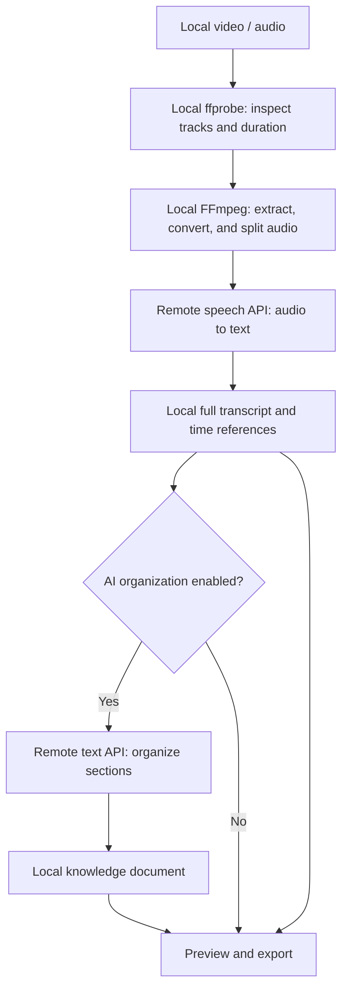

# 爱呵呵 · 听记 — AIhehe Tingji

**Turn videos, recordings, and podcasts into documents you can read, search, and use with AI.**

A Windows desktop application developed by **爱呵呵 (AIhehe)** and built with Rust. Its minimal dark interface connects to your own speech recognition and text model APIs to produce full transcripts and optional knowledge documents from local media.

[中文](README.md) · English

Current version: **0.2.3** · Platform: **Windows** · Application UI: **Chinese**

**Download: [Windows x64 portable package](https://github.com/Slash214/aihehe-tingji/releases/download/v0.2.3/aihehe-tingji-v0.2.3-windows-x64.zip) · [Release notes and checksums](https://github.com/Slash214/aihehe-tingji/releases/latest)**

## Features

- Import one video, one audio file, or a video with a separate audio file.
- Fetch and search a provider's model list, or enter a model ID manually.
- Configure speech recognition and document organization independently, including different providers.
- Test the selected model with a real request before starting a task.
- Keep a complete transcript and optionally generate a knowledge document with key points, methods, examples, and action steps.
- Preserve completed audio segments and document sections so interrupted tasks can resume.
- Export Markdown, plain text, and JSON segments with timing information.

No local AI model or dedicated GPU is required. Recognition and organization run through remote APIs, so an internet connection and a working provider account are required.

## Quick start

### Using the packaged desktop application

1. Extract the Windows portable package. Keep the entire `tools` folder beside `爱呵呵听记.exe`.
2. Launch `爱呵呵听记.exe` and open **API 设置** (API settings).
3. Under **语音识别** (speech recognition), enter the endpoint and API key, fetch and select a speech model, choose the appropriate protocol, and click **测试连接** (test connection).
4. To generate a knowledge document, configure and test a text model under **文档整理** (document organization). For transcription only, disable **同时生成 AI 知识文档**.
5. Select your media on the home screen, start processing, then preview and export the result.

Windows requires **Microsoft Edge WebView2 Runtime**. Users of the portable package do not need Rust, Python, or Node.js. The application does not include API keys; model usage is billed by your chosen provider.

Keyboard shortcuts: `Ctrl+O` selects a file; `Ctrl+,` opens API settings.

### What if the video has no audio?

The application checks for an audio track before calling the speech API. If the video has none, add a separate audio file on the home screen. When both are selected, **only the separate audio is transcribed; the video is retained as a source reference**.

Timestamps refer to the separate audio. The application does not synchronize it with the video. It cannot recover content from images or subtitles when no audio is available. A track containing only silence is not detected in advance.

## How it works



1. **Inspect the input.** The local Rust service receives the files and uses ffprobe to check duration and audio tracks. A separate audio file takes priority when both video and audio are supplied.
2. **Prepare the audio.** FFmpeg converts it to 16 kHz, mono, 16-bit PCM WAV and splits it into segments. The generic transcription protocol uses approximately five-minute segments; the supported Alibaba Cloud protocols use approximately three-minute segments.
3. **Call the speech model.** A protocol adapter constructs a file upload or Base64 audio request and parses the provider's response. Results are saved segment by segment, with time references adjusted for each segment's starting position.
4. **Organize the content.** If enabled, the transcript is divided into sections of approximately 9,000 characters and sent to a text model to produce structured Markdown. The original transcript is retained independently, even if organization fails.
5. **Save and resume.** Task state, completed speech segments, and document sections are cached locally. After restarting and re-entering an API key, unfinished tasks can resume. Reusing completed speech segments requires matching speech settings.

**FFmpeg does not understand speech.** It processes media; the speech API recognizes words, and the text API organizes them. Tao / Wry and WebView2 provide the desktop window. HTML, CSS, and JavaScript resources are embedded in the executable, while Axum / Tokio run the local Rust task service.

**“Learning with AI” means supplying reading material here.** Exported documents can be uploaded to an AI chat tool or separately imported into a knowledge base / RAG system. This application does not fine-tune models, update model weights, or automatically submit documents to a third-party knowledge base.

## API and model compatibility

A successfully fetched model list only confirms access to the model catalog. **It does not mean every listed model supports audio transcription.** Different providers and model families may require different protocols.

| Purpose / protocol | Supported scope | Request format and timing |
| --- | --- | --- |
| Generic speech transcription | Whisper-style and compatible services | `POST /audio/transcriptions`, multipart file upload; sentence timestamps require model support for `verbose_json` |
| Alibaba Cloud native speech | `qwen-audio-3.0-asr-flash`, `qwen-audio-3.1-asr-flash`, and `fun-asr-flash` families | Native DashScope HTTP endpoint, JSON with Base64 audio; segment-level time ranges |
| Qwen audio messages | `qwen3-asr-flash` and dated variants | `POST /chat/completions`, `input_audio` messages; segment-level time ranges |
| Document organization | Text services supporting Chat Completions | `POST /chat/completions`, transcript text |

Automatic matching selects the protocol for known model families on official Alibaba Cloud hosts. You can keep the provider's `/compatible-mode/v1` base address: native speech requests use the appropriate path on the **same host**, without forwarding the key to another provider.

Third-party gateways may remap model endpoints. Select the protocol manually according to the gateway's documentation and test it. Unknown models are not guaranteed to work. Other protocols or families such as Realtime, Streaming, Message, Filetrans, and Paraformer are not currently adapted.

### What does the connection test check?

- Speech testing sends an embedded audio sample of approximately four seconds, using the selected model, language, and timestamp settings.
- Text testing sends a short message and checks whether the response is usable by the application.
- Speech testing and actual transcription share the same request and parsing code. The test does not merely check the model list, and it does not automatically try alternative protocols after a failure.
- Tests may incur a small provider charge. They do not send your media or retry automatically. Changing settings clears the previous test status.

A successful short request does not guarantee that a long task will succeed: quota, network conditions, file duration, and context limits can still affect it. Development validation uses local mock APIs; account permissions and deployment availability must be checked with your own key.

## Data and privacy

| Data | Destination / storage |
| --- | --- |
| Source copies, audio segments, task state, transcripts, and knowledge documents | Stored in `data/` beside the executable by default; not automatically deleted on exit |
| Audio segments | Sent to your configured speech API |
| Transcript text | Sent to your configured text API only when organization is enabled |
| API keys | Used by the current page and running tasks; the application does not intentionally persist them to disk, localStorage, or task files; re-enter after refreshing or restarting |
| Non-secret endpoint, model, and language settings | Stored in the local WebView profile |

The local service listens on `127.0.0.1:8765` by default, uses an access token generated at startup, and restricts cross-origin access. Remote APIs require HTTPS; HTTP is allowed only for loopback development endpoints. Error messages do not directly expose raw provider response bodies.

Local files are not additionally encrypted. After closing the application, you can back up exported documents and remove task folders you no longer need. Do not commit personal `data/`, real keys, or private media to a public repository.

## Outputs and recovery

| Output | Contents |
| --- | --- |
| `transcript.md` | Full transcript, source information, and time references |
| `transcript.txt` | Plain-text transcript |
| `knowledge.md` | Knowledge document generated when AI organization is enabled |
| `segments.json` | Transcript segments, timing, and precision information |

When sentence-level timestamps are unavailable, the application labels segment time ranges instead of inventing precise subtitle timing. Sentence timestamps depend on model support for the generic protocol; the native Alibaba Cloud and Qwen audio-message adapters currently provide segment ranges.

Resume a failed task from recent documents. If successful speech segments are cached, keep the speech endpoint, model, protocol, language, and timestamp settings unchanged; the key can be re-entered. If no speech segment succeeded, you can change the model or protocol before resuming. Failed text organization preserves the original transcript and completed sections.

## Build from source

Prerequisites:

- A stable Rust toolchain supporting the Rust 2024 edition.
- Windows C++ build tools and the Windows SDK.
- Microsoft Edge WebView2 Runtime.
- `ffmpeg.exe` and `ffprobe.exe` in a `tools/` folder at the project root.
- Python 3, only for integration tests.

Run from the project root:

```powershell
cargo test --locked
.\build.ps1
.\爱呵呵听记.exe
```

`build.ps1` creates a release build and copies it to `爱呵呵听记.exe` in the project root. Close any running desktop instance before rebuilding so the executable can be replaced. There is no Node.js build step.

For a debug build, specify the media tool directory explicitly:

```powershell
$env:AIHEHE_FFMPEG_DIR = Join-Path $PWD 'tools'
cargo run --locked
```

### Development checks

```powershell
cargo clippy --all-targets --locked -- -D warnings
cargo build --locked
python tests/smoke.py
```

Integration tests use a local mock API and real FFmpeg in temporary directories to exercise model lists, connection tests, protocol adapters, transcription, segmentation, and task recovery. They do not call real cloud models and do not replace compatibility checks against an actual provider account.

### Environment variables

| Variable | Purpose / default |
| --- | --- |
| `AIHEHE_FFMPEG_DIR` | Media tool directory; lookup order is `tools/` beside the executable, this variable, then system PATH |
| `AIHEHE_DATA` | Data directory; defaults to `data/` beside the executable |
| `AIHEHE_PORT` | Local service port; defaults to `8765` |

The application opens a desktop window by default. For development, run `aihehe-transcriber.exe --serve` to start only the local engine.

### Project layout

```text
src/main.rs        Local service, media processing, tasks, and persistence
src/desktop.rs     Desktop window, file dialogs, and exit handling
src/speech.rs      Speech protocols, requests, and response parsing
src/connection.rs  Real model invocation tests
src/models.rs      Model catalog requests
web/               Embedded HTML / CSS / JavaScript interface
assets/            Icons and connection-test audio
tests/smoke.py     Integration tests with local mock endpoints
build.ps1          Windows release build script
start.bat          Portable application launcher
tools/             Locally supplied FFmpeg / ffprobe; excluded from source control
data/              Local application data; excluded from source control
```

## Current limitations

- One task at a time. Total input size must be slightly below 2 GiB to leave room for upload overhead; batch queues are not implemented.
- Fixed-duration segments may split sentences. Silence-aware splitting, overlap deduplication, and speaker diarization are not implemented.
- Long documents are organized section by section and may contain repetition. Recognition and generated notes can contain errors; review them against the original audio.
- No visual OCR, slide / code-frame extraction, subtitle reading, video URL downloads, automatic audio-video alignment, or Word export.
- The current desktop application targets Windows and has a Chinese UI. Its macOS-inspired appearance does not imply macOS support.

## Author and licensing

Application developer: **爱呵呵 (AIhehe)**.

A source-code license has not yet been selected; this project currently has no `LICENSE` file. Third-party components retain their respective licenses. Speech recognition and text generation are provided by the model services configured by the user.

FFmpeg runs as a separate tool, and its binaries are not included in the source repository. When distributing a portable package with FFmpeg, retain the license and source information for that build; these materials are in `tools/` in the existing portable package. Rust dependency versions are recorded in `Cargo.lock`.

## API references

- [Alibaba Cloud Qwen-Audio / Fun-ASR Flash HTTP API](https://help.aliyun.com/zh/model-studio/fun-asr-flash-recorded-speech-recognition-http-api)
- [Qwen3-ASR API](https://help.aliyun.com/zh/model-studio/qwen-asr-api-reference)
- [OpenAI speech-to-text documentation](https://developers.openai.com/api/docs/guides/speech-to-text)
- [OpenAI Chat Completions documentation](https://developers.openai.com/api/reference/resources/chat)
