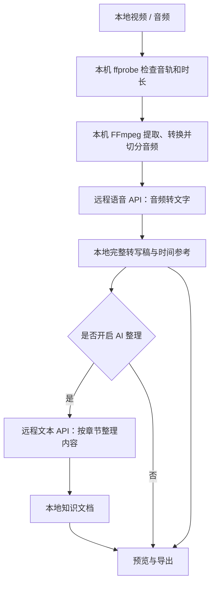

# 爱呵呵 · 听记

**把视频、录音和播客，整理成可阅读、可检索、可交给 AI 使用的文档。**

由 **爱呵呵** 开发的 Windows 桌面工具，使用 Rust 构建，提供简洁的深色界面。通过你自己的语音识别和文本模型 API，将本地音视频转为完整转写稿，并按需生成知识文档。

中文 · [English](README.en.md)

当前版本：**0.2.3** · 平台：**Windows** · 界面语言：**中文**

**下载桌面版：[Windows x64 便携包](https://github.com/Slash214/aihehe-tingji/releases/download/v0.2.3/aihehe-tingji-v0.2.3-windows-x64.zip) · [版本说明与校验文件](https://github.com/Slash214/aihehe-tingji/releases/latest)**

## 能做什么

- 导入一个视频、一个音频，或「视频 + 独立音频」。
- 获取服务商的模型列表，搜索、选择模型，也可手动填写模型 ID。
- 分别配置语音识别和文档整理接口，支持使用不同服务商。
- 实际调用所选模型测试连接，提前发现接口、权限或响应格式问题。
- 保存完整转写稿，按需生成包含要点、方法、案例与行动步骤的 AI 知识文档。
- 保留已完成的音频段和整理章节，失败后可以继续处理。
- 导出 Markdown、纯文本和带时间信息的分段 JSON。

无需安装本地 AI 模型，也不要求独立显卡。识别与整理通过远程 API 完成，需要网络和可用的服务商账户。

## 快速开始

### 使用打包好的桌面版

1. 解压 Windows 便携版，保留 `爱呵呵听记.exe` 旁的整个 `tools` 文件夹。
2. 双击 `爱呵呵听记.exe`，进入「API 设置」。
3. 在「语音识别」中填写接口地址和 API Key，获取并选择语音模型。选择合适的接口类型，点击「测试连接」。
4. 如需生成知识文档，在「文档整理」中配置文本模型并测试；只需要转写稿时，关闭「同时生成 AI 知识文档」。
5. 返回首页选择素材，开始处理，完成后预览并导出文档。

Windows 需要 **Microsoft Edge WebView2 Runtime**。便携版用户无需安装 Rust、Python 或 Node.js。软件不附带 API Key，模型调用费用由所选服务商收取。

快捷键：`Ctrl+O` 选择文件，`Ctrl+,` 打开 API 设置。

### 视频没有声音怎么办？

如果视频没有音轨，程序会在请求语音 API 前提示补充音频。可以在首页同时选择视频和一份独立音频；此时**只转写独立音频，视频作为来源文件保留**。

时间位置以独立音频为准，程序不会自动同步或对齐视频。只有无声视频、没有任何音频时，当前版本无法通过画面或字幕恢复内容。已有音轨但全程静音的情况，目前不做预检测。

## 软件原理



1. **读取素材。** Rust 本地服务接收文件，使用 ffprobe 检查时长和音轨。同时提供视频和音频时，独立音频优先。
2. **处理音频。** FFmpeg 将音频转换为 16 kHz、单声道、16-bit PCM WAV，再按接口类型切分。通用转写接口每段约 5 分钟；已适配的阿里云接口每段约 3 分钟。
3. **调用语音模型。** 协议适配层构造文件上传或 Base64 音频请求，解析服务商返回的文字。逐段保存结果，并结合音频段的起始时间记录时间参考。
4. **整理知识。** 开启整理后，将转写文字按约 9000 个字符分章发送给文本模型，生成结构化 Markdown。完整转写稿独立保存，整理失败不会丢掉已经完成的转写。
5. **保存和恢复。** 本地保存任务状态、已完成音频段和整理章节。重启后重新填写 Key，可继续未完成的任务；已有转写缓存时，需要保持相同的语音配置。

**FFmpeg 本身不负责理解语音。** 它只处理媒体；语音 API 负责识别，文本 API 负责整理。桌面窗口由 Tao / Wry 和 WebView2 提供，HTML、CSS、JavaScript 界面资源编译进程序，Rust 使用 Axum / Tokio 提供本机任务服务。

**“交给 AI 学习”在这里指提供阅读材料。** 导出文档后，可以上传给 AI 对话工具，或自行导入知识库 / RAG 系统。本程序不会自动微调模型、更新模型权重，也不会自动把文档提交到第三方知识库。

## API 与模型兼容范围

获取到模型列表，只能说明模型目录可访问，**不代表其中每个模型都能转写音频**。不同服务商、不同模型家族可能使用不同请求协议。

| 用途 / 接口类型 | 当前适配范围 | 请求方式与时间信息 |
| --- | --- | --- |
| 通用语音转写 | Whisper 风格及兼容服务 | `POST /audio/transcriptions`，multipart 文件上传；逐句时间戳需要模型支持 `verbose_json` |
| 阿里云原生语音 | `qwen-audio-3.0-asr-flash`、`qwen-audio-3.1-asr-flash`、`fun-asr-flash` 系列 | DashScope 原生 HTTP 接口，JSON + Base64 音频；标注音频段范围 |
| 千问音频消息 | `qwen3-asr-flash` 及日期版本 | `POST /chat/completions`，`input_audio` 消息；标注音频段范围 |
| 文档整理 | 支持 Chat Completions 的文本模型服务 | `POST /chat/completions`，发送转写文字 |

「自动匹配」会在阿里云官方域名上按已知模型家族选择协议。可保留服务商提供的 `/compatible-mode/v1` 地址；调用原生语音接口时，程序在**同一域名**下转换请求路径，不向其他服务商转发 Key。

第三方网关可能重新映射模型接口，需要根据该网关的说明手动选择接口类型，再测试连接。未知模型不保证兼容。Realtime、Streaming、Message、Filetrans、Paraformer 等其他协议或模型家族当前未适配。

### “测试连接”具体测试什么？

- 语音测试使用内置约 4 秒的测试音频，按当前模型、语言及时间戳配置发起真实请求。
- 文本测试发送一条短测试消息，检查返回内容能否被程序使用。
- 语音测试与正式转写共用请求和解析模块；不会只检查模型列表，也不会失败后自动轮流尝试其他协议。
- 测试可能产生少量服务商费用，不会发送你的素材，也不会自动重试。更改配置会清除旧测试状态。

短请求成功不能保证长任务始终成功，后续仍可能受到额度、网络、文件长度和上下文限制影响。当前开发验证使用本地模拟 API；真实账户权限和部署可用性，需要使用自己的 Key 确认。

## 数据与隐私

| 数据 | 去向 / 保存方式 |
| --- | --- |
| 源文件副本、音频分段、任务状态、转写和知识文档 | 默认保存在程序旁的 `data/` 目录，不会随退出自动清理 |
| 音频分段 | 发送给你配置的语音 API |
| 转写文字 | 仅在开启整理时发送给你配置的文本 API |
| API Key | 用于当前页面与运行中的任务；程序不主动写入磁盘、localStorage 或任务文件，刷新或重新启动后需填写 |
| 接口地址、模型、语言等非密钥设置 | 保存在本机 WebView 配置中 |

本机服务默认监听 `127.0.0.1:8765`，使用每次启动生成的访问令牌，并限制跨域访问。远程 API 要求 HTTPS；HTTP 仅允许本机回环地址用于开发。错误提示不直接回显服务商响应正文。

本地资料未额外加密。退出程序后，可备份导出文档并删除不再需要的任务目录；不要把个人 `data/`、真实密钥或私人素材提交到公开仓库。

## 输出与恢复

| 输出 | 内容 |
| --- | --- |
| `transcript.md` | 完整转写稿、来源与时间参考 |
| `transcript.txt` | 纯文本转写稿 |
| `knowledge.md` | 开启 AI 整理后生成的知识文档 |
| `segments.json` | 转写分段、时间及精度信息 |

没有逐句时间戳时，只标注音频段的时间范围，不生成虚假的精确字幕。通用接口的逐句时间戳取决于模型支持；阿里云原生和千问音频消息适配当前使用分段范围。

任务失败后，可从最近文档中继续。已有成功转写缓存时，需保持语音地址、模型、协议、语言和时间戳设置一致；Key 可以重新填写。若首次转写就失败、没有成功缓存，可以修改模型或协议后继续。文本整理失败时，原始转写稿和已完成章节仍会保留。

## 从源码构建

准备以下环境：

- 支持 Rust 2024 edition 的 Rust stable 工具链。
- Windows C++ 构建工具和 Windows SDK。
- Microsoft Edge WebView2 Runtime。
- `ffmpeg.exe` 与 `ffprobe.exe`，放入项目根目录的 `tools/` 文件夹。
- Python 3：仅运行集成测试时需要。

在项目根目录执行：

```powershell
cargo test --locked
.\build.ps1
.\爱呵呵听记.exe
```

`build.ps1` 执行 release 构建，并将产物复制为根目录下的 `爱呵呵听记.exe`。重新构建前请关闭正在运行的桌面程序，以便替换 EXE。界面没有 Node.js 构建步骤。

使用调试构建运行时，明确指定媒体工具目录：

```powershell
$env:AIHEHE_FFMPEG_DIR = Join-Path $PWD 'tools'
cargo run --locked
```

### 开发验证

```powershell
cargo clippy --all-targets --locked -- -D warnings
cargo build --locked
python tests/smoke.py
```

集成测试使用本机模拟 API 和真实 FFmpeg，在临时目录中验证模型列表、连接测试、协议适配、转写、分段、任务恢复等流程，不调用真实云端模型。它不能替代服务商实际账户下的兼容性验证。

### 环境变量

| 变量 | 作用 / 默认值 |
| --- | --- |
| `AIHEHE_FFMPEG_DIR` | 媒体工具目录；优先查找 EXE 旁的 `tools/`，其次此变量，最后系统 PATH |
| `AIHEHE_DATA` | 数据目录；默认 EXE 旁的 `data/` |
| `AIHEHE_PORT` | 本机服务端口；默认 `8765` |

默认启动桌面窗口。开发时可使用 `aihehe-transcriber.exe --serve` 只启动本机引擎。

### 项目结构

```text
src/main.rs        本地服务、媒体处理、任务与文档持久化
src/desktop.rs     桌面窗口、文件对话框与退出处理
src/speech.rs      语音协议适配、请求与响应解析
src/connection.rs  模型实际调用测试
src/models.rs      模型列表请求
web/               内嵌 HTML / CSS / JavaScript 界面
assets/            图标与连接测试音频
tests/smoke.py     本地模拟接口集成测试
build.ps1          Windows release 构建脚本
start.bat          便携版启动脚本
tools/             本机准备的 FFmpeg / ffprobe，不提交到源码仓库
data/              本机运行数据，不提交到源码仓库
```

## 当前限制

- 一次处理一个任务。输入总大小略小于 2 GiB，为上传协议预留空间；暂不支持批量队列。
- 固定时长切分可能截断句子，尚未实现静音切分、重叠去重或说话人分离。
- 长文分章整理可能出现重复，转写和 AI 整理也可能存在错误，需要对照原音频检查。
- 不支持画面 OCR、PPT / 代码画面提取、字幕读取、视频链接下载、自动音画对齐或 Word 导出。
- 当前提供 Windows 桌面版和中文界面；macOS 风格仅指视觉设计。

## 作者与许可证

产品开发者：**爱呵呵**。

项目源码许可证尚待作者确定，当前未附带 `LICENSE` 文件。第三方组件遵循各自许可证，语音识别与文本生成由用户配置的模型服务提供。

FFmpeg 作为独立工具调用，源码仓库不包含其二进制文件。分发包含 FFmpeg 的便携包时，应保留对应构建的许可证和来源说明；现有便携包的相关材料位于 `tools/`。Rust 依赖的版本由 `Cargo.lock` 记录。

## 接口参考

- [阿里云 Qwen-Audio / Fun-ASR Flash HTTP API](https://help.aliyun.com/zh/model-studio/fun-asr-flash-recorded-speech-recognition-http-api)
- [千问 Qwen3-ASR API](https://help.aliyun.com/zh/model-studio/qwen-asr-api-reference)
- [OpenAI 语音转写文档](https://developers.openai.com/api/docs/guides/speech-to-text)
- [OpenAI Chat Completions 文档](https://developers.openai.com/api/reference/resources/chat)
